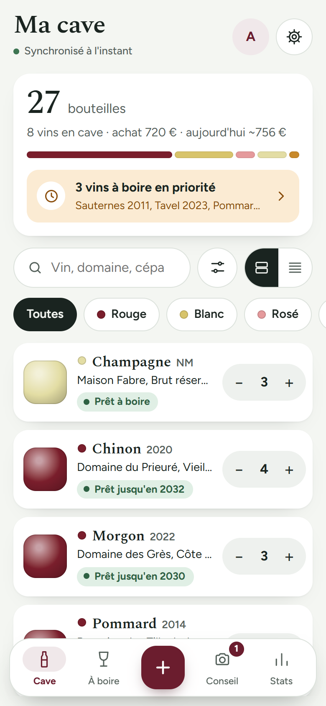
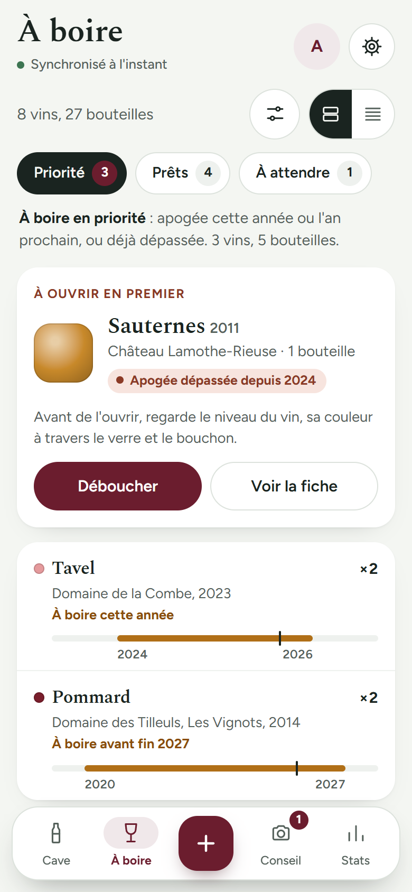
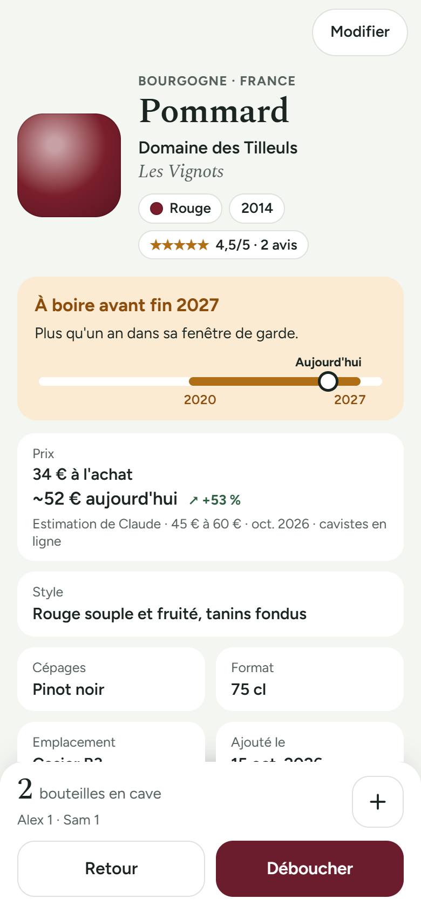
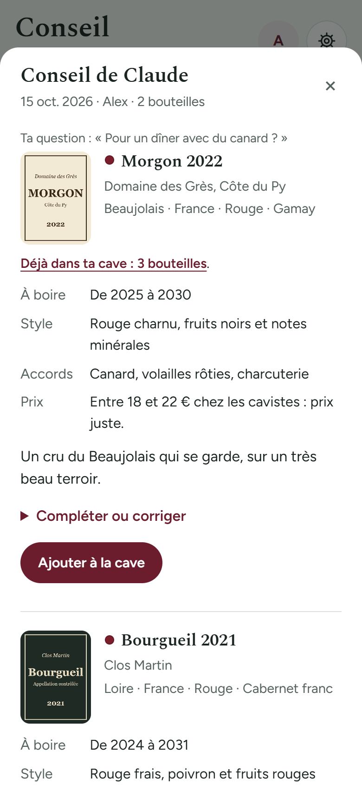

# Ma cave partagée

Une appli pour tenir sa cave à vin à plusieurs : les bouteilles, celles à boire en premier, qui a débouché quoi, les avis de chacun et quelques statistiques. Elle fonctionne sur téléphone, tablette et ordinateur, même hors connexion. En option, Claude lit les étiquettes, conseille en magasin et estime la valeur des bouteilles.

<p align="center">
  
  
  
  
</p>

## Utiliser l'appli

- **Sur le web**, sur n'importe quel appareil : **[gregbe41.github.io/ma-cave](https://gregbe41.github.io/ma-cave/)**
- **Sur Android** : télécharge `ma-cave.apk` dans la **[dernière version](https://github.com/gregbe41/ma-cave/releases/latest)**, puis ouvre-le sur le téléphone. Le guide [ANDROID.md](ANDROID.md) détaille l'installation.

L'appli s'ouvre sur une cave vide. Pour la relier à une cave, colle dans **Réglages** l'adresse du script et le code secret, ou ouvre le lien d'invitation reçu d'un proche.

## Où sont les données ?

Chaque cave vit dans **un Google Sheet**, dans le Drive de la personne qui l'héberge, avec un petit script Google attaché. Les photos d'étiquettes vont dans un dossier de ce même Drive. Rien n'est stocké sur GitHub ni chez l'auteur de l'appli. Chaque appareil garde une copie pour fonctionner hors connexion, et se synchronise dès qu'il le peut.

## Créer sa propre cave

Il faut une dizaine de minutes, une seule fois, pour la personne qui héberge la cave :

1. **Créer le Google Sheet et installer le script** : suis [INSTALLATION.md](INSTALLATION.md). Tu obtiens une adresse et un code secret.
2. **Relier tes appareils** : ouvre l'appli, va dans **Réglages**, colle l'adresse et le code.
3. **Inviter tes proches** : **Réglages › Inviter quelqu'un** envoie un lien qui relie leur appareil à ta cave.

Le pas-à-pas complet, y compris pour préparer une appli déjà reliée à ta cave pour ta famille : [PARTAGE.md](PARTAGE.md).

## Claude, en option

| Ce que fait Claude | Comment l'activer | Coût |
|---|---|---|
| Lire une étiquette tout de suite, conseiller en magasin | Une clé API dans le script ([INSTALLATION.md](INSTALLATION.md), étape 8) | environ 3,5 centimes par étiquette |
| Lire les étiquettes la nuit, compléter les fiches, chercher la valeur du jour | Une routine Claude ([routine/consigne.md](routine/consigne.md)) | compris dans un abonnement Claude |

Sans Claude, tout se saisit à la main : l'appli ne promet alors aucune lecture automatique.

## Guides

| Guide | Pour qui |
|---|---|
| [INSTALLATION.md](INSTALLATION.md) | La personne qui héberge une cave : Google Sheet, script, Claude |
| [PARTAGE.md](PARTAGE.md) | Partager l'appli, créer sa cave, préparer l'appli de sa famille, mettre à jour |
| [ANDROID.md](ANDROID.md) | Installer l'appli Android, ou la construire soi-même |

## Pour les développeurs

```
index.html          toute l'appli (HTML, CSS et JavaScript, un seul fichier), servie par GitHub Pages
apps-script/        le script Google (Code.gs) et son manifeste (appsscript.json)
android-app/        l'appli Android (Capacitor) qui embarque index.html
routine/            la consigne de la routine Claude, avec {{ADRESSE}} et {{CODE_ROUTINE}} à remplacer
docs/captures/      les captures de ce fichier
```

- **Construire l'APK** : `cd android-app && npm ci && npm run apk:generique` donne `android-app/dist/ma-cave.apk`.
- **Publier une version** : `git tag v1.2.0 && git push origin v1.2.0`. GitHub Actions construit l'APK, le signe et le joint à la version. Le secret `ANDROID_KEYSTORE_B64` doit être en place pour que l'APK puisse mettre à jour celui déjà installé.
- **Ne jamais pousser** : `android-app/cave.local.json` (adresse et code d'une cave), `android-app/www/`, `android-app/dist/` et les clés de signature. Le fichier `.gitignore` les écarte.
